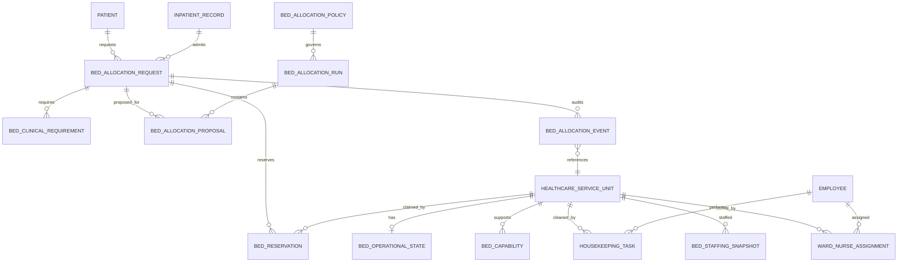

# Domain Model and Schema (Phase 1)

**Status:** Scaffolded as native Frappe v15 DocTypes in
`hospital_operations/`. Not installed on any site; no `bench migrate` has been
run. Field definitions below are generated from the committed DocType JSON and
are the authoritative description of the current code.

**Authoritative existing records (never duplicated):**

| Concern | Existing DocType | Owner |
|---|---|---|
| Patient identity | `Patient` | Marley |
| Admission / transfer / discharge | `Inpatient Record` | Marley |
| Physical occupancy | `Inpatient Occupancy` (child) | Marley |
| Physical space | `Healthcare Service Unit` | Marley |
| Ward category / tariff | `Healthcare Service Unit Type` | Marley |
| Staffing raw signals | `Employee`, `Shift Assignment`, `Attendance`, `Leave Application` | HRMS |
| Billing | `Sales Invoice`, `Item` | ERPNext |

The operational layer is additive. Occupancy is derived from
`Inpatient Occupancy`; `Bed Operational State` only describes readiness and
must never contradict Marley occupancy.

---

## 1. ER Overview



---

## 2. DocType: `Bed Allocation Request`

**File:** `hospital_operations/hospital_operations/hospital_operations/doctype/bed_allocation_request/`
**Autoname:** `format:BAR-{#####}` · **Track changes:** yes · **Submittable:** no

| # | Field | Type | Options / notes |
|---:|---|---|---|
| 1 | `patient` | Link | `Patient`, required, indexed, in list/filter |
| 2 | `patient_name` | Data | `fetch_from: patient.patient_name`, read-only |
| 3 | `inpatient_record` | Link | `Inpatient Record` |
| 4 | `column_break_1` | Column Break | |
| 5 | `source` | Select | `ED / OPD / OT / Transfer / Direct Admission`, required |
| 6 | `priority` | Select | `Emergency / Urgent / Routine`, required, indexed |
| 7 | `care_level` | Select | `ICU / General / Special / Other`, required |
| 8 | `section_break_1` | Section Break | Lifecycle |
| 9 | `requested_at` | Datetime | default `Now`, required |
| 10 | `requested_by` | Link | `User`, default `__user`, read-only |
| 11 | `status` | Select | `PENDING / ELIGIBILITY_CHECKED / PROPOSED / RESERVED / ALLOCATED / WAITLISTED / CANCELLED`, required, indexed |
| 12 | `column_break_2` | Column Break | |
| 13 | `company` | Link | `Company` |
| 14 | `medical_department` | Link | `Medical Department` |
| 15 | `policy_version` | Data | policy snapshot used |
| 16 | `clinical_approval_reference` | Data | approval for override/expedited path |
| 17 | `idempotency_key` | Data | unique, indexed |
| 18 | `section_break_2` | Section Break | Clinical Requirements |
| 19 | `clinical_requirements` | Table | `Bed Clinical Requirement` |
| 20 | `section_break_3` | Section Break | |
| 21 | `notes` | Small Text | operational notes only |

**Validation:** duplicate idempotency key rejected; duplicate clinical
requirement rows `(type, operator, value)` rejected.

---

## 3. DocType: `Bed Clinical Requirement` (child)

**Autoname:** none · **Is table:** yes · **Own permissions:** none

| # | Field | Type | Options / notes |
|---:|---|---|---|
| 1 | `requirement_type` | Select | `ICU_LEVEL / VENTILATOR / OXYGEN / ISOLATION / CARDIAC_MONITORING / ACCESSIBILITY / SPECIALTY / OTHER`, required |
| 2 | `operator` | Select | `= / != / >= / <= / IN / NOT IN`, default `=` |
| 3 | `required_value` | Data | required |
| 4 | `mandatory` | Check | default 1; mandatory rows are hard constraints |
| 5 | `clinical_reason` | Small Text | justification, not used in audit logs |

---

## 4. DocType: `Bed Capability`

**Autoname:** `format:BCAP-{#####}`

| # | Field | Type | Options / notes |
|---:|---|---|---|
| 1 | `healthcare_service_unit` | Link | `Healthcare Service Unit`, required, indexed |
| 2 | `capability_type` | Select | `ICU_LEVEL / VENTILATOR / OXYGEN / ISOLATION / CARDIAC_MONITORING / ACCESSIBILITY / SPECIALTY / MONITORING / OTHER`, required |
| 3 | `capability_value` | Data | equipment level / specialty code |
| 4 | `column_break_1` | Column Break | |
| 5 | `enabled` | Check | default 1 |
| 6 | `valid_from` | Datetime | optional window |
| 7 | `valid_until` | Datetime | optional window; must be after `valid_from` |
| 8 | `section_break_1` | Section Break | |
| 9 | `notes` | Small Text | |

**Validation:** `valid_until > valid_from` when both set. Only currently valid,
enabled rows may satisfy eligibility.

---

## 5. DocType: `Bed Operational State`

**Autoname:** `field:healthcare_service_unit` (one row per physical unit)

| # | Field | Type | Options / notes |
|---:|---|---|---|
| 1 | `healthcare_service_unit` | Link | `Healthcare Service Unit`, required, **unique**, indexed |
| 2 | `state` | Select | `READY / RESERVED / OCCUPIED / VACATED / CLEANING_REQUIRED / CLEANING_IN_PROGRESS / ISOLATION_CLEANING / MAINTENANCE / BLOCKED`, default `READY`, indexed |
| 3 | `ready_at` | Datetime | set when entering `READY` |
| 4 | `column_break_1` | Column Break | |
| 5 | `version` | Int | optimistic-lock counter, read-only |
| 6 | `last_changed_by` | Link | `User`, read-only |
| 7 | `last_changed_at` | Datetime | read-only |
| 8 | `section_break_1` | Section Break | |
| 9 | `reason` | Small Text | |

**Validation:** transitions must follow the state machine below; every state
change increments `version` and stamps actor/time. `READY` sets `ready_at`.

### Bed lifecycle

```text
READY -> RESERVED -> OCCUPIED -> VACATED -> CLEANING_REQUIRED
      -> CLEANING_IN_PROGRESS -> READY
```

Exceptional paths: `MAINTENANCE`, `BLOCKED`, `ISOLATION_CLEANING`.
`VACATED` may never jump directly to `READY`; cleaning is mandatory.
`OCCUPIED -> READY` is forbidden. The transition table is implemented in
`hospital_operations/bed_allocation/state.py` and covered by unit tests.

---

## 6. DocType: `Bed Reservation`

**Autoname:** `format:BRES-{#####}`

| # | Field | Type | Options / notes |
|---:|---|---|---|
| 1 | `allocation_request` | Link | `Bed Allocation Request`, required, indexed |
| 2 | `healthcare_service_unit` | Link | `Healthcare Service Unit`, required, indexed |
| 3 | `reservation_type` | Select | `IMMEDIATE / TRANSFER / POST_OPERATIVE`, default `IMMEDIATE` |
| 4 | `status` | Select | `ACTIVE / CONFIRMED / EXPIRED / CANCELLED`, default `ACTIVE`, indexed |
| 5 | `column_break_1` | Column Break | |
| 6 | `start_at` | Datetime | default `Now`, required |
| 7 | `expires_at` | Datetime | required, must be after `start_at` |
| 8 | `created_by` | Link | `User`, default `__user`, read-only |
| 9 | `confirmed_at` | Datetime | read-only, stamped on confirmation |
| 10 | `idempotency_key` | Data | required, unique, indexed |
| 11 | `section_break_1` | Section Break | |
| 12 | `inpatient_record` | Link | `Inpatient Record` |
| 13 | `reason` | Small Text | |

**Database guarantee:** generated stored column
`active_immediate_claim = healthcare_service_unit` when
`status='ACTIVE' AND reservation_type='IMMEDIATE'`, otherwise `NULL`, with a
unique index `uq_bres_active_immediate_claim`. MariaDB therefore allows at most
one active immediate claim per physical bed, independent of application code.
Future/time-window reservations require overlap checks under row locks
(Phase 4).

---

## 7. DocType: `Bed Staffing Snapshot`

**Autoname:** `format:BSS-{#####}`

| # | Field | Type | Options / notes |
|---:|---|---|---|
| 1 | `ward` | Link | `Healthcare Service Unit`, required, indexed |
| 2 | `shift` | Link | `Shift Type` |
| 3 | `calculated_at` | Datetime | default `Now`, required, indexed |
| 4 | `column_break_1` | Column Break | |
| 5 | `available_nurses` | Int | actually present/available, not merely scheduled |
| 6 | `qualified_nurses` | Int | competency-matched |
| 7 | `current_patients` | Int | workload at calculation time |
| 8 | `staffed_bed_capacity` | Int | clinically approved capacity |
| 9 | `policy_version` | Data | staffing policy snapshot |
| 10 | `section_break_1` | Section Break | |
| 11 | `notes` | Small Text | |

Snapshots are derived evidence, not a second occupancy source of truth.

---

## 8. DocType: `Bed Allocation Policy`

**Autoname:** `format:BAP-{#####}`

| # | Field | Type | Options / notes |
|---:|---|---|---|
| 1 | `policy_name` | Data | required |
| 2 | `version` | Data | required; `(policy_name, version)` must be unique |
| 3 | `enabled` | Check | default 1 |
| 4 | `column_break_1` | Column Break | |
| 5 | `reservation_expiry` | Int | minutes, default 120 |
| 6 | `section_break_1` | Section Break | Rules (JSON) |
| 7 | `clinical_priority_rules` | Code (JSON) | ordered priority rules |
| 8 | `eligibility_rules` | Code (JSON) | hospital-configured hard rules |
| 9 | `cost_weights` | Code (JSON) | optimiser weights |
| 10 | `waiting_time_rules` | Code (JSON) | waiting-time policy |
| 11 | `manual_override_permissions` | Code (JSON) | authorised override roles/conditions |
| 12 | `section_break_2` | Section Break | |
| 13 | `notes` | Small Text | |

**Validation:** unique `(policy_name, version)`; all JSON fields must parse.
Clinical thresholds live here, never in Python defaults.

---

## 9. DocType: `Bed Allocation Run`

**Autoname:** `field:run_id`

| # | Field | Type | Options / notes |
|---:|---|---|---|
| 1 | `run_id` | Data | required, unique, indexed |
| 2 | `algorithm` | Data | default `min_cost_flow` |
| 3 | `status` | Select | `PENDING / RUNNING / COMPLETED / FAILED`, default `PENDING` |
| 4 | `column_break_1` | Column Break | |
| 5 | `started_at` | Datetime | |
| 6 | `completed_at` | Datetime | |
| 7 | `execution_duration_ms` | Int | |
| 8 | `section_break_1` | Section Break | |
| 9 | `policy` | Link | `Bed Allocation Policy` |
| 10 | `policy_version` | Data | |
| 11 | `input_hash` | Data | deterministic input snapshot hash, indexed |
| 12 | `column_break_2` | Column Break | |
| 13 | `request_count` | Int | |
| 14 | `eligible_bed_count` | Int | |
| 15 | `assigned_count` | Int | |
| 16 | `unassigned_count` | Int | |
| 17 | `section_break_2` | Section Break | |
| 18 | `error_log` | Long Text | read-only |

---

## 10. DocType: `Bed Allocation Proposal`

**Autoname:** `format:BAPR-{#####}`

| # | Field | Type | Options / notes |
|---:|---|---|---|
| 1 | `allocation_run` | Link | `Bed Allocation Run`, required, indexed |
| 2 | `allocation_request` | Link | `Bed Allocation Request`, required, indexed |
| 3 | `proposed_bed` | Link | `Healthcare Service Unit`, required |
| 4 | `status` | Select | `PROPOSED / CONFIRMED / REJECTED / STALE / CANCELLED`, default `PROPOSED` |
| 5 | `column_break_1` | Column Break | |
| 6 | `cost` | Currency | optimiser cost |
| 7 | `priority` | Select | `Emergency / Urgent / Routine` |
| 8 | `bed_state_version` | Int | expected version for stale rejection |
| 9 | `section_break_1` | Section Break | |
| 10 | `eligibility_summary` | Small Text | structured summary |
| 11 | `explanation` | Long Text | human-readable selection reason |

Proposals are advisory; confirmation revalidates everything under lock.

---

## 11. DocType: `Bed Allocation Event`

**Autoname:** `format:BAE-{#####}` · **Append-only**

| # | Field | Type | Options / notes |
|---:|---|---|---|
| 1 | `event_type` | Select | request / eligibility / proposal / reservation / admission / transfer / discharge / housekeeping / override / state events, required, indexed |
| 2 | `timestamp` | Datetime | default `Now`, required, indexed |
| 3 | `actor` | Link | `User`, default `__user`, read-only |
| 4 | `column_break_1` | Column Break | |
| 5 | `correlation_id` | Data | indexed |
| 6 | `section_break_1` | Section Break | |
| 7 | `patient_reference` | Link | `Patient` |
| 8 | `inpatient_record` | Link | `Inpatient Record` |
| 9 | `allocation_request` | Link | `Bed Allocation Request` |
| 10 | `bed` | Link | `Healthcare Service Unit` |
| 11 | `column_break_2` | Column Break | |
| 12 | `previous_state` | Data | |
| 13 | `new_state` | Data | |
| 14 | `section_break_2` | Section Break | |
| 15 | `reason` | Small Text | |
| 16 | `details` | Code (JSON) | operational metadata only; no clinical notes |

**Enforcement:** controller rejects updates and deletes. Created through
`hospital_operations.utils.audit.log_event`, which truncates reason text and
stores only operational JSON.

---

## 12. DocType: `Housekeeping Task`

**Autoname:** `format:HK-{#####}`

| # | Field | Type | Options / notes |
|---:|---|---|---|
| 1 | `healthcare_service_unit` | Link | `Healthcare Service Unit`, required, indexed |
| 2 | `task_type` | Select | `DISCHARGE_CLEAN / ISOLATION_CLEAN / DEEP_CLEAN / MAINTENANCE_CLEAN / OTHER` |
| 3 | `status` | Select | `PENDING / IN_PROGRESS / COMPLETED / VERIFIED / CANCELLED`, default `PENDING`, indexed |
| 4 | `column_break_1` | Column Break | |
| 5 | `assigned_employee` | Link | `Employee` |
| 6 | `started_at` | Datetime | |
| 7 | `completed_at` | Datetime | auto-stamped |
| 8 | `section_break_1` | Section Break | Verification |
| 9 | `verified_by` | Link | `User` |
| 10 | `verified_at` | Datetime | auto-stamped |
| 11 | `section_break_2` | Section Break | |
| 12 | `notes` | Small Text | |

**Transitions:** `PENDING -> IN_PROGRESS -> COMPLETED -> VERIFIED`;
`CANCELLED` only before verification. A bed may only return to `READY` after
the linked task is `VERIFIED` (wired in Phase 5).

---

## 13. DocType: `Ward Nurse Assignment`

**Autoname:** `format:WNA-{#####}`

| # | Field | Type | Options / notes |
|---:|---|---|---|
| 1 | `employee` | Link | `Employee`, required, indexed |
| 2 | `ward` | Link | `Healthcare Service Unit`, required, indexed |
| 3 | `competency` | Select | `GENERAL / ICU / PEDIATRIC / ISOLATION / EMERGENCY / OTHER` |
| 4 | `column_break_1` | Column Break | |
| 5 | `valid_from` | Date | |
| 6 | `valid_to` | Date | not before `valid_from` |
| 7 | `active` | Check | default 1 |

Fills the verified gap: HRMS has no employee-to-ward or clinical-competency
mapping.

---

## 14. Additive Custom Fields on `Healthcare Service Unit`

Created idempotently by `hospital_operations.install.ensure_custom_fields`
(never by editing upstream source):

| Field | Type | Purpose |
|---|---|---|
| `ho_ward` | Link -> `Healthcare Service Unit` | ward-level parent of a bed |
| `ho_is_allocatable` | Check (default 0) | opt-in marker for beds offered by this engine |
| `ho_care_level` | Select (`ICU / General / Special / Other`) | bed care level |

These are additive; existing Marley fields remain untouched.

---

## 15. Indexes and Database Constraints

Defined in `hospital_operations/install.py` and applied by `after_migrate`
and the `v0_1.ensure_schema_constraints` patch:

| Table | Index / constraint |
|---|---|
| Bed Allocation Request | `(status, priority, requested_at)`, `(patient)` |
| Bed Capability | `(healthcare_service_unit, capability_type)` |
| Bed Reservation | `(healthcare_service_unit, status)`, `(expires_at, status)` |
| Bed Reservation | generated `active_immediate_claim` + **unique** `uq_bres_active_immediate_claim` |
| Bed Allocation Proposal | `(allocation_run)` |
| Housekeeping Task | `(healthcare_service_unit, status)` |
| Bed Staffing Snapshot | `(ward, calculated_at)` |

DocType-level uniques: request idempotency key, reservation idempotency key,
service unit on operational state, run id.

---

## 16. Permission Matrix (Phase 1 baseline)

| DocType | System Mgr | HO Admin | Bed Mgr | Admission Coord. | Nursing Sup. | Housekeeping | Healthcare Admin |
|---|---|---|---|---|---|---|---|
| Bed Allocation Request | full | full | CRW | CRW | CRW | – | CRWD |
| Bed Clinical Requirement | child | child | child | child | child | – | child |
| Bed Capability | full | full | CRW | – | CRW | – | – |
| Bed Operational State | full | full | CRW | – | CRW | CRW | CRWD |
| Bed Reservation | full | full | CRW | CRW | CRW | – | – |
| Bed Staffing Snapshot | full | full | CRW | – | CRW | – | – |
| Bed Allocation Policy | full | full | R | – | R | – | – |
| Bed Allocation Run | full | full | CRW | – | R | – | – |
| Bed Allocation Proposal | full | full | CRW | CRW | R | – | – |
| Bed Allocation Event | CR | CR | R | R | R | – | R |
| Housekeeping Task | full | full | CRW | – | CRW | CRW | – |
| Ward Nurse Assignment | full | full | R | – | CRW | – | CRWD |

C = create, R = read, W = write, D = delete; `full` includes delete/import/export.
Permission tests live in `hospital_operations/tests/test_roles.py`
(requires a bench to execute).

---

## 17. Explicit Non-Goals in This Schema

- No duplicate `Patient`, `Inpatient Record`, occupancy or employee table.
- No bed/room table replacing `Healthcare Service Unit`.
- No billing fields or invoice creation on allocation documents.
- No hidden "discharged" shortcut that frees a bed without cleaning.
- No clinical diagnosis/prescription data in audit events.

## 18. Open Schema Risks

1. Marley server-side admission validation has not been exercised on a bench.
2. The generated-column constraint assumes MariaDB (confirmed platform).
3. Post-operative overlapping reservations rely on row-level locking added in
   Phase 4, not yet implemented.
4. Role permissions must be re-tested with a least-privilege service user; the
   discovery token is `Administrator`.
